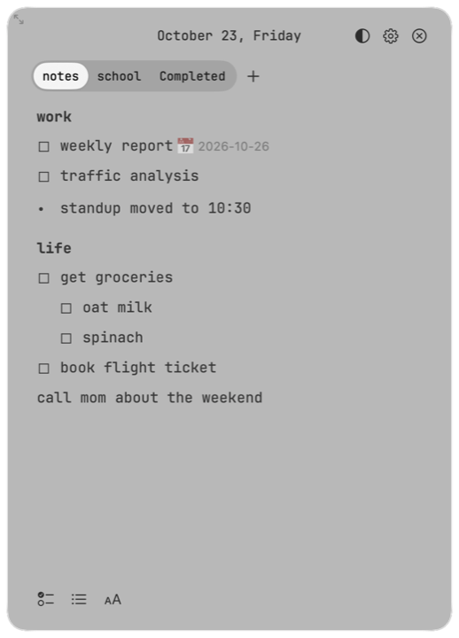
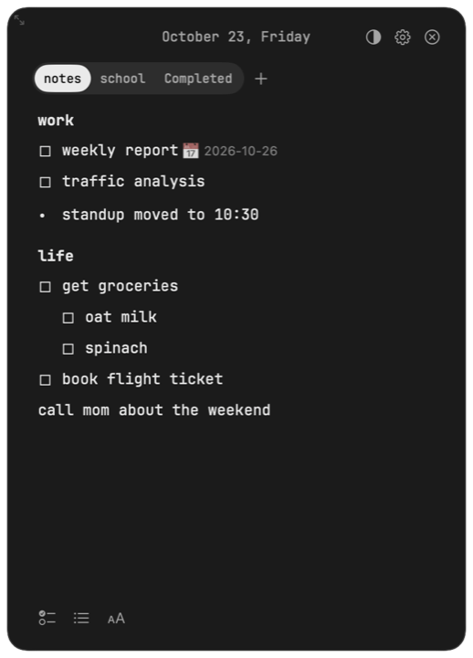

# Glance

[](https://github.com/kekidev/notes-reminder/actions/workflows/ci.yml)
[](https://github.com/kekidev/notes-reminder/releases/latest)

[](LICENSE)

**A tiny notepad that floats on your Mac.** Click the orb, jot something down, click again and it's gone. Your notes are a plain Markdown file that never leaves your computer.

<p align="center">
  
</p>

<p align="center">
  
  &nbsp;
  
</p>

## The problem

To-do apps live in a window you forget to open, so the list goes stale. And every time you plan something with your AI, you copy the tasks out by hand.

Glance is a list you can't lose: a small orb on top of everything that you check at a glance, and that Claude can add to straight from chat.

## Features

- **Always one click away.** A small glass orb sits on top of every app and every Space. It shows how many things you still have open. Drag it anywhere and it stays there.
- **Types like Apple Notes.** Every page is one real text editor. Return continues a list, Tab and Shift-Tab indent, Backspace joins lines, and ⌘Z undoes.
- **Checklists, bullets, and headings.** Type `[] `, `- `, or `# ` at the start of a line, or use the bar at the bottom.
- **Crossed off, not lost.** Check something off and it moves to the **Completed** tab after a moment. Uncheck it there to bring it back.
- **Pages.** Keep `school`, `groceries`, and `work` apart. Add, rename, or delete a page right in the panel.
- **Looks like macOS 26.** Liquid Glass, with a transparency slider, a resizable panel, light and dark mode, and JetBrains Mono.
- **Reminders.** Add `📅 2026-10-26` to a line to get a notification when it's due.
- **Works with your AI assistant.** A local MCP server lets Claude Desktop read your list, suggest tasks, and add them when you ask. It only runs over stdio and opens no network ports.

## Install

1. **[Download Glance.dmg](../../releases/latest/download/Glance.dmg)**, open it, and drag **Glance** onto the **Applications** folder.
2. Open Glance from Applications or Launchpad. macOS will say it can't verify the app, because it isn't notarized. Click **Done**, then go to **System Settings → Privacy & Security**, scroll down, and click **Open Anyway** next to Glance. You only do this once.
   - Or paste this into Terminal instead: `xattr -dr com.apple.quarantine /Applications/Glance.app`
3. Click the orb in the top-right corner, or press **⌥Space** from anywhere.

Requires macOS 26 (Tahoe) on Apple silicon.

## Your notes

Everything lives in one file, `~/Documents/Glance/todo.md`. Edit it in any text editor and the panel updates within a second.

```markdown
## school
### this week
- [ ] hw 6 📅 2026-10-26
  - [ ] problem 3
- [x] read chapter 4 ✅ 2026-10-23
- office hours moved to thursday
```

`##` is a page, `###` is a heading, `- [ ]` is a checklist item, `- ` is a bullet, and anything else is a plain line. Lines Glance doesn't recognise are kept exactly as they are.

## Keyboard

| Keys | Action |
|---|---|
| ⌥Space | Open Glance and start typing |
| Return | New line (continues a checklist or bullet list) |
| Tab / ⇧Tab | Indent / outdent |
| ⇧⌘L | Toggle checklist |
| ⌘Z / ⇧⌘Z | Undo / redo |

## Connect Claude Desktop

Open **Settings → Connect Claude Desktop…**. Glance shows you the config change first and backs up your old config, then asks you to restart Claude Desktop. If you'd rather use the terminal, run `scripts/install-mcp.sh`.

You can also add this to your custom instructions:

> You have Glance. When I mention something I need to do, call `suggest_tasks`. Only call `add_task` when I explicitly say "add".

Suggestions show up in the panel with ✓ and ✕ buttons, so nothing lands on your list until you accept it.

## Build from source

```sh
brew install xcodegen swiftlint
xcodegen generate
scripts/build.sh        # writes dist/Glance.app and dist/Glance.dmg
scripts/check.sh        # lint and tests, the same checks CI runs
```

The code is split into `Sources/GlanceCore` (the Markdown parser, serializer, and atomic file store), `Sources/glance-mcp` (the MCP server), and `App/Glance` (the SwiftUI and AppKit app).

## Privacy

Glance has no accounts, no analytics, no telemetry, and no network code. Your notes stay in a file on your Mac.

## License

MIT. See [LICENSE](LICENSE).
